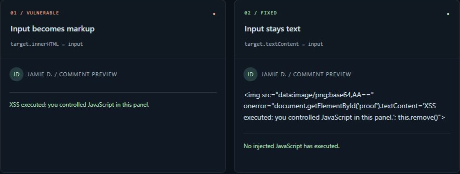

# Exploit your first XSS vulnerability

**Find the flaw. Prove the fix.** A guided DOM XSS investigation in a realistic comment-preview feature: observe unsafe HTML rendering, demonstrate JavaScript execution, repair the sink, and regression-test your patch.



## What this project demonstrates

- Three guided challenges: **Observe → Demonstrate → Remediate**.
- A vulnerable comment preview next to a corrected implementation.
- A third preview that runs your editable `renderComment` function.
- A local proof of execution that changes a message inside a sandboxed iframe.
- A starter exercise, a working solution, and regression tests that preserve the entire comment.
- Browser tests for execution, literal text, isolation, reset, report export, and mobile layout.
- An investigation notebook that exports Markdown, plus a technical report and screenshots.
- GitHub Actions for unit/regression tests and the browser suite.

This is an **educational demonstration of an intentional flaw**, not a vulnerability discovered in a third-party product. It has no accounts, sessions, database, or stored comments. Run it locally and test only systems you own or are authorized to assess.

## Run locally

Install Node.js **22 or newer** (24 recommended), then open a terminal in this folder:

```sh
npm start
```

Open **http://127.0.0.1:3000**. Stop the server with `Ctrl+C`.

The app has no runtime dependencies; `npm install` is only needed for the optional browser tests. If PowerShell blocks `npm.ps1`, use `npm.cmd start` or `node server.mjs`.

If port 3000 is occupied, stop the other instance or use another local port:

```powershell
$env:PORT = "3001"
node server.mjs
```

On macOS/Linux: `PORT=3001 node server.mjs`.

## Follow the investigation

| Challenge | Task | Evidence |
| --- | --- | --- |
| 01 · Observe | Load `<b>This comment should be plain text.</b>` | Only the vulnerable preview creates a bold element. |
| 02 · Demonstrate | Load the provided invalid-image payload | The event handler changes the message only in the vulnerable frame. |
| 03 · Remediate | Repair `renderComment` and run regressions | Your renderer preserves all input as literal text and creates no injected elements. |

Use **Load challenge input** to try each example. Hints and expected observations explain what to look for. **Mark this step reviewed** is a self-review checklist, not an automated security check. Progress and notes reset when you reload; export notes before leaving.

For the coding exercise, follow [the patching guide](docs/EXERCISE.md). The project ships with the **working solution** so all unit and regression tests pass. A separate starter lets you deliberately reintroduce the flaw and reproduce failing tests.

## Understand the root cause

```text
User-controlled comment → input.value → JSON transport → isolated iframe
                                                        │
                                  ┌─────────────────────┴────────────────────┐
                                  ▼                                          ▼
                         innerHTML = input                         textContent = input
                         HTML + event handlers                     literal comment text
```

`innerHTML` parses markup. An invalid image can trigger its injected `onerror` handler, demonstrating execution even though script tags inserted through `innerHTML` generally do not execute by that mechanism.

For this feature, the requirement is **plain text**. Assigning to `textContent` on a normal text container keeps the input as data. This is not a universal fix for URL, CSS, attribute, or JavaScript contexts. Applications that intentionally accept HTML need a maintained, context-appropriate sanitizer and a carefully defined formatting policy.

See [the technical report](docs/REPORT.md) for the complete reproduction, impact boundaries, and remediation rationale. [OWASP recommends safe text sinks for this use case.](https://cheatsheetseries.owasp.org/cheatsheets/DOM_based_XSS_Prevention_Cheat_Sheet.html)

## Test

Unit and exercise regression tests, without dependency installation:

```sh
npm test
```

Optional real-browser tests:

```sh
npm install
npx playwright install chromium
npm run test:browser
```

The browser tests launch an isolated browser and fulfill requests using the actual HTTP handler and its CSP headers. You do not need to keep a server running. This verifies rendering and interaction, but does not test socket transport. On Linux CI, use `npx playwright install --with-deps chromium`.

See [test coverage and verification evidence](docs/TESTING.md). The checked-in screenshots come from the local lab. Do not infer that the browser suite passed just from their presence.

## Repository map

```text
public/
  index.html                    Accessible interface and sandboxed previews
  style.css                     Desktop and mobile layouts
  app.js                        Challenge navigation, notes, and controls
  lab.mjs                       Demonstration, editable renderer, frame builder
exercises/
  comment-renderer.starter.mjs   Intentionally vulnerable exercise function
  comment-renderer.solution.mjs  Reference solution
scripts/
  exercise.mjs                  Start/reset the exercise without replacing other code
server.mjs                      Local HTTP server with an explicit file allowlist
test/
  lab.test.mjs                  Transport, sink, and HTTP handler checks
  exercise.test.mjs             Editable renderer regression cases
  browser/lab.test.mjs          Playwright browser scenarios
docs/
  EXERCISE.md                   Guided patching exercise
  REPORT.md                     Technical vulnerability report
  TESTING.md                    Coverage, commands, and verification status
  images/                       Captured evidence
.github/workflows/test.yml      Unit and browser CI jobs
```

## Scope and limitations

The server binds to `127.0.0.1`. Preview iframes allow scripts but omit `allow-same-origin`, isolating them from the parent document. CSP restricts resources and connections; the example image uses invalid local `data:` content instead of an external request.

Inline script is deliberately allowed to demonstrate the event handler. These controls reduce the example's reach; arbitrary JavaScript can still freeze a frame or tab. Use the documented inputs, do not enter personal data, and do not deploy the vulnerable lab as a public application. Review [the security policy](SECURITY.md) before reporting issues.

## Get the source

```sh
git clone https://github.com/fdias27/dom-xss-lab.git
cd dom-xss-lab
npm start
```

To practice independently, fork this repository and follow [the patching guide](docs/EXERCISE.md). Use your own investigation notes to explain what you learned. Do not present checklist completion or generated documentation as an independent security audit.

## References

- [OWASP — DOM based XSS Prevention](https://cheatsheetseries.owasp.org/cheatsheets/DOM_based_XSS_Prevention_Cheat_Sheet.html)
- [MDN — innerHTML security considerations](https://developer.mozilla.org/en-US/docs/Web/API/Element/innerHTML)
- [Playwright documentation](https://playwright.dev/docs/intro)

## License

[MIT](LICENSE).
